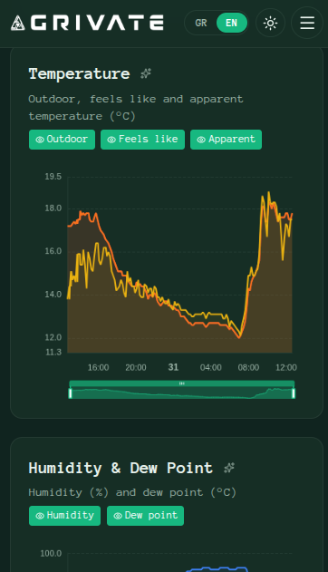
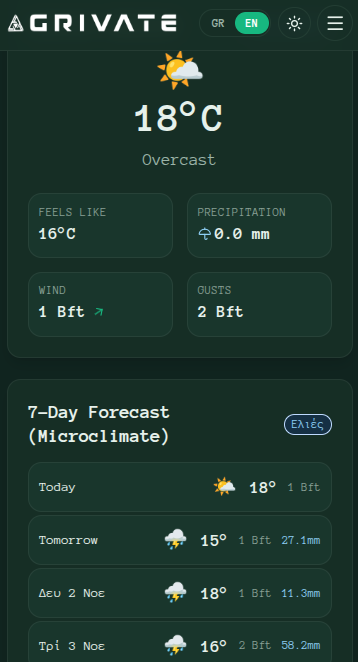
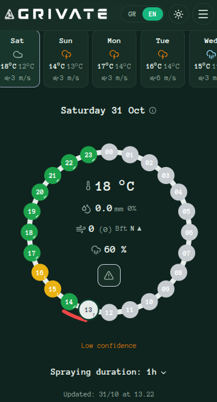
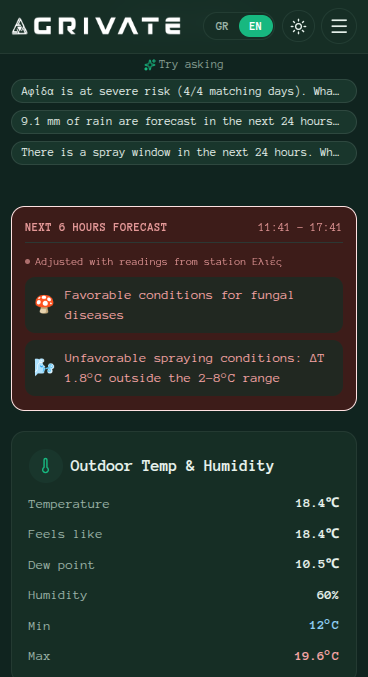
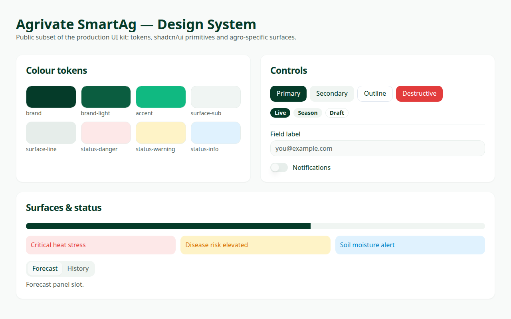

<div align="center">
  
</div>

# Agrivate SmartAg — Engineering Showcase

> A public, sanitised view of **Agrivate SmartAg**, a production agri-tech SaaS that turns weather-station and IoT sensor data into agronomic decisions for farmers and agronomists.

### 👉 Live demo — [app.agrivate.eu](https://app.agrivate.eu)

[](#tests)
[](https://www.typescriptlang.org/)
[](https://react.dev/)
[](LICENSE)

---

## Why this repository exists

The commercial Agrivate platform (multi-tenant API, ingestion workers, infrastructure and customer data) is private. This repository is a **representative slice of the engineering work** behind it — the parts that show architecture, code quality and agronomic domain modelling without disclosing business-critical implementation:

| Included | Purpose |
|----------|---------|
| [`docs/ARCHITECTURE.md`](docs/ARCHITECTURE.md) | System design, data flow, design decisions |
| [`docs/DESIGN_SYSTEM.md`](docs/DESIGN_SYSTEM.md) | Brand tokens, typography scale, component conventions |
| [`packages/shared-types/`](packages/shared-types) | Strictly typed domain model + **pure agronomic engines** (spray windows, disease risk, wind/Beaufort, ΔT) with unit tests |
| [`src/components/ui/`](src/components/ui) | The production shadcn/ui primitive layer |
| [`src/styles/design-system.css`](src/styles/design-system.css) | Brand token + base-layer CSS |
| [`src/DesignSystemShowcase.tsx`](src/DesignSystemShowcase.tsx) | Runnable catalog of the design system |

Deliberately **excluded**: API routes, database schema and migrations, orchestration/CI-CD, environment configuration, third-party integrations, translations and all customer data.

---

## Screenshots

| Forecast & microclimate | Spray-window ring |
|:---:|:---:|
|  |  |
| **AI insight card** | **Interactive historical charts** |
|  |  |

*Captured from the live application at [app.agrivate.eu](https://app.agrivate.eu).*

---

## Design system



*Rendered from this repo — `npm run dev`.*

---

## Quick start

```bash
npm install
npm run dev        # design-system showcase → http://localhost:5174
npm test           # agronomic engine unit tests (vitest)
npm run typecheck  # strict TS across app + shared types
npm run build      # production bundle
```

---

## What the code demonstrates

### 1. Pure, testable domain logic

The agronomic engines in [`packages/shared-types/src`](packages/shared-types/src) are dependency-free and fully deterministic — no I/O, no clock reads, no framework coupling. Everything the decision depends on is passed in, which makes an entire spraying day unit-testable and lets the API layer stay a thin orchestration shell.

```
sprayAssistEngine.ts   merge forecast sources → blend station microclimate → evaluate spray phases
disease.ts             canonical disease-risk model shared by frontend and backend
spray.ts / wind.ts     ΔT thresholds and Beaufort conversions, one implementation everywhere
```

- **27 unit tests** cover the highest-risk paths (threshold merging, microclimate blend decay, phase verdicts, band boundaries).
- The same package is consumed by the web app, the API and the scheduled worker — one source of truth, no logic drift.

### 2. Typed contracts as an integration boundary

Domain types are defined once and shared across every runtime. Frontend and backend cannot disagree about the shape of a forecast, a measurement or a decision.

### 3. Design system with brand tokens

A single token layer (`brand`, `surface`, `status`, `accent`) drives both light and dark themes, with a documented typographic scale and pastel status surfaces for agronomic alerts.

### 4. Engineering practice

Strict TypeScript everywhere, no `any` in domain code, conventional commits, and changes documented before they ship.

---

## Repository layout

```
docs/                        Architecture & design-system documentation
packages/shared-types/       Domain types + pure agronomic engines (+ tests)
src/components/ui/           shadcn/ui primitive layer used by the product
src/styles/design-system.css Brand tokens, base layer, DS utilities
src/DesignSystemShowcase.tsx Runnable component catalog
```

---

Copyright © Agrivate. All rights reserved. See [LICENSE](LICENSE).
