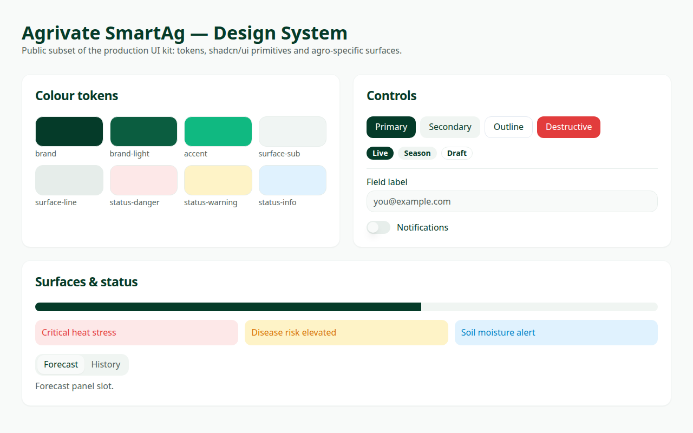

# Design System

Agrivate SmartAg uses a token-driven design system: one layer of CSS custom properties and Tailwind extensions, a set of shadcn/ui primitives, and a handful of agronomic surfaces (alert bands, metric tiles).



---

## 1. Tokens

Defined in [`tailwind.config.ts`](../tailwind.config.ts) and [`src/styles/design-system.css`](../src/styles/design-system.css).

| Token | Value | Usage |
|-------|-------|-------|
| `brand` | `#053B29` | Headings, primary text, dark icons |
| `brand.light` | `#0B5D40` | Hover / secondary emphasis |
| `brand.deep` | `#042E21` | Overlays, high-contrast surfaces |
| `accent` | `#10B981` | Live indicators, chart lines, toggles |
| `accent.active` | `#00A86B` | Selected state |
| `surface.app` | `#F8FAF9` | Page background |
| `surface.card` | `#FFFFFF` | Card background |
| `surface.sub` | `#F0F5F3` | Metric tiles, icon circles |
| `surface.line` | `#E6EDEA` | Hairline borders |

### Status surfaces

Semantic, low-saturation pairs used for agronomic alerts — colour alone never carries meaning, every band is paired with a label.

| Class | Background / Text | Meaning |
|-------|-------------------|---------|
| `.alert-danger` | `#FDE8E8` / `#E53E3E` | Critical heat stress, hard constraints |
| `.alert-warning` | `#FEF3C7` / `#D97706` | Disease risk, caution |
| `.alert-info` | `#E0F2FE` / `#0284C7` | Moisture / informational |

---

## 2. Typography

The product is used outdoors on phones, so the base scale is upscaled (≈ ×16/14) around **Anonymous Pro** with `Inter` / `Plus Jakarta Sans` fallbacks:

| Utility | Size / Line height |
|---------|--------------------|
| `text-xs` | 0.875rem / 1.125rem |
| `text-sm` | 1rem / 1.4375rem |
| `text-base` | 1.125rem / 1.75rem |
| `text-lg` | 1.25rem / 2rem |
| `text-xl` | 1.4375rem / 2rem |
| `text-2xl` | 1.75rem / 2.25rem |

Spacing and layout stay on the default rem grid, so the enlarged type never breaks layout maths.

---

## 3. Components

Primitives live in [`src/components/ui`](../src/components/ui) and follow shadcn/ui conventions:

- **Composition over configuration** — variants via `class-variance-authority`, never ad-hoc prop flags.
- **Accessible by default** — Radix primitives supply focus management, ARIA wiring and keyboard behaviour.
- **Class merging** — every component uses the `cn()` helper ([`src/lib/utils.ts`](../src/lib/utils.ts)) so consumer styling wins deterministically.
- **Slot-based** — `asChild` support where the underlying primitive offers it.

Run the catalog:

```bash
npm run dev   # http://localhost:5174
```

---

## 4. Motion

Small, purposeful keyframes only: `fade-in`, `scale-in`, `accordion-down/up` (Radix height animation) and `animate-pulse-soft` for live indicators. Motion is always secondary to information — no decorative animation competes with a reading.
